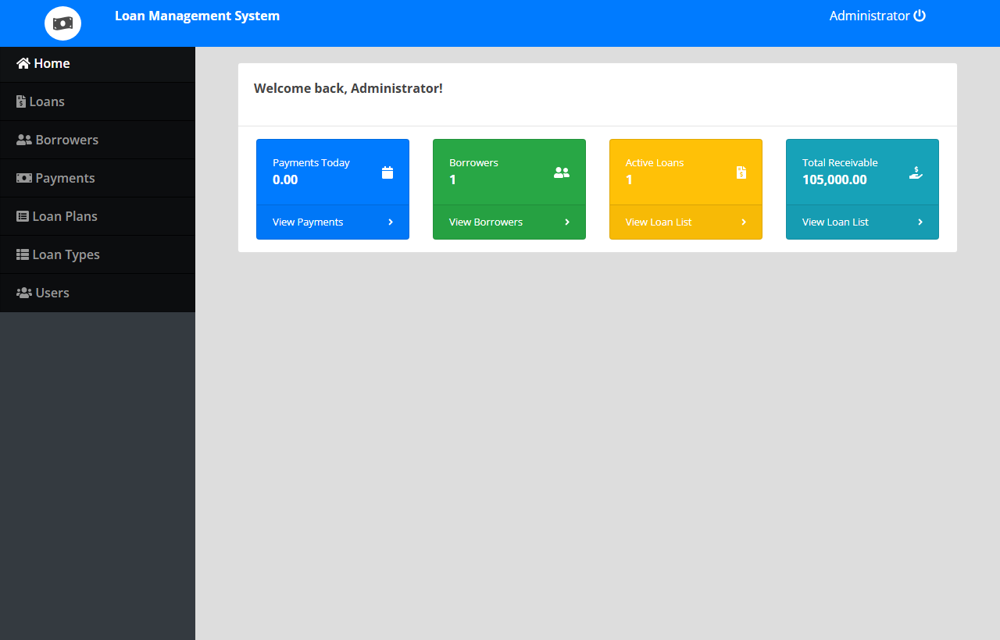
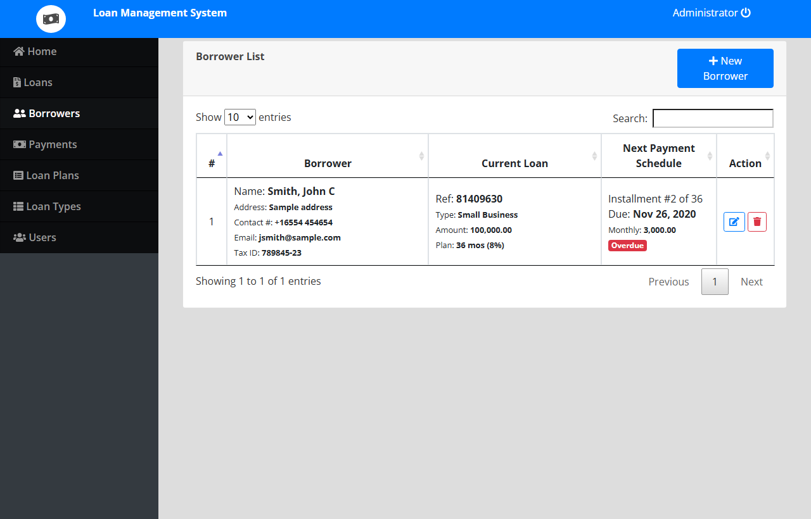
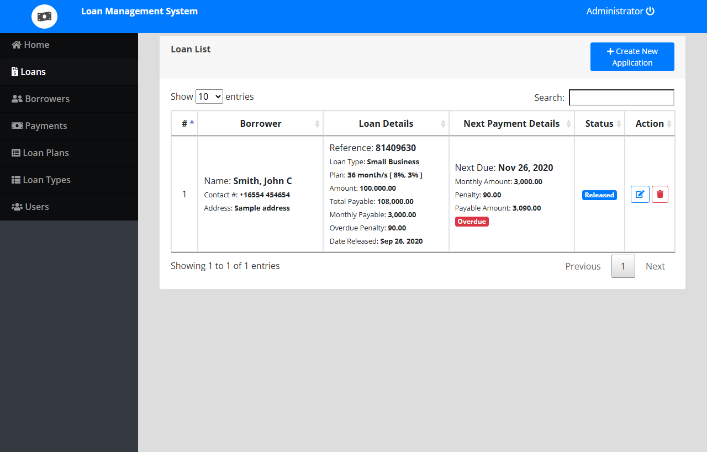
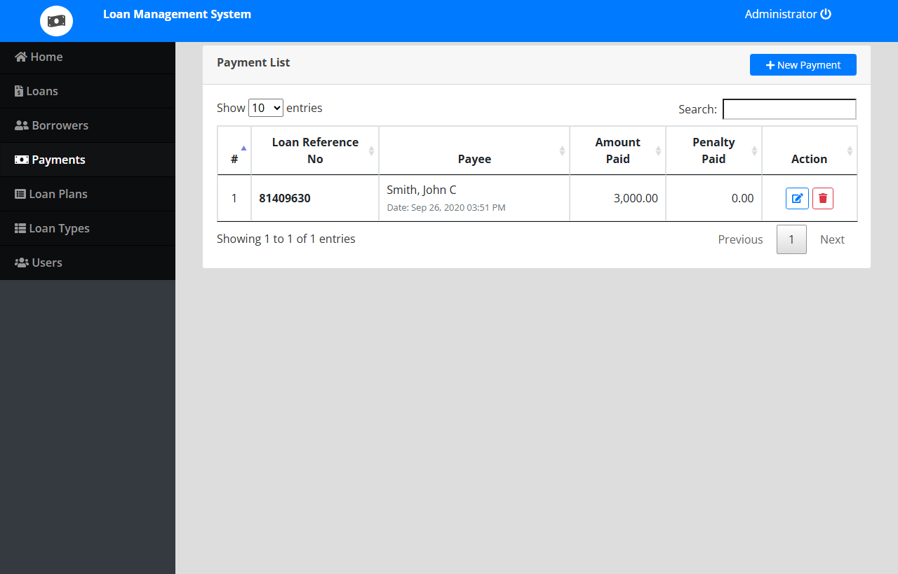
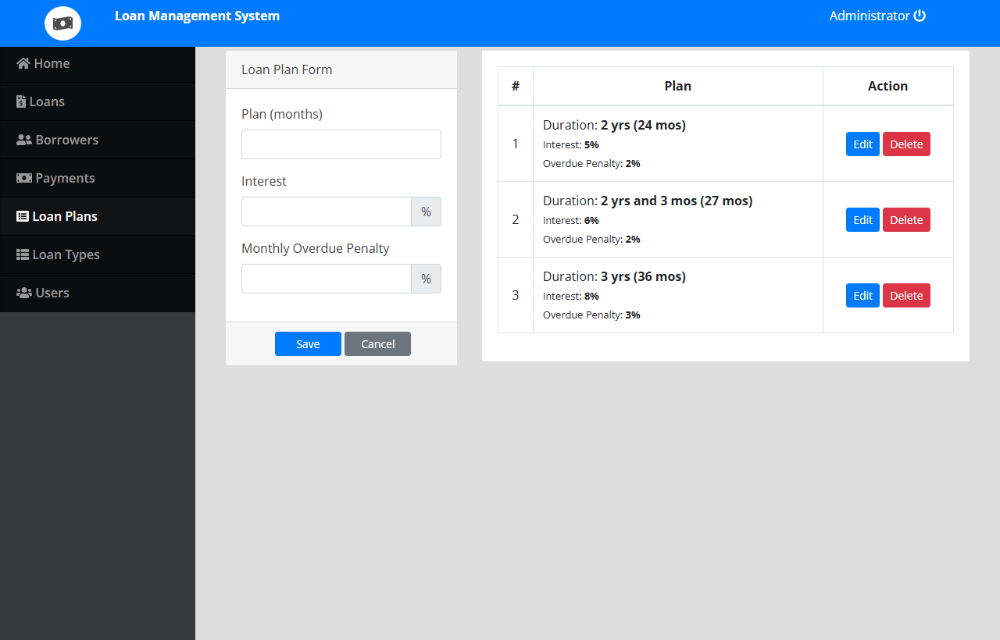
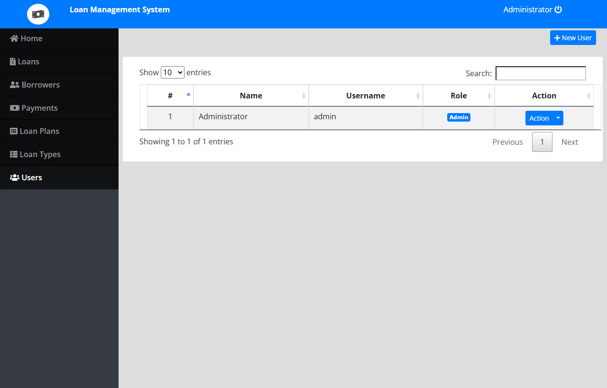

# Loan Management System

[](#technology-stack)
[](#database-architecture)
[](#technology-stack)
[-brightgreen)](#security-architecture)
[-success)](#testing--verification)

> **Academic Background**: This project originated as a **Diploma in Computer Engineering** final-year capstone project by **[mnp210](https://github.com/mnp210)**. It has been enhanced into a secure, modular, and documented portfolio web application.

---

## Table of Contents

- [Overview](#overview)
- [Key Features](#key-features)
- [Application Screenshots](#application-screenshots)
- [Technology Stack](#technology-stack)
- [System Architecture](#system-architecture)
- [Database Schema](#database-schema)
- [Installation & Setup](#installation--setup)
- [Security Architecture](#security-architecture)
- [Testing & Verification](#testing--verification)
- [Project Documentation](#project-documentation)
- [Known Limitations & Future Scope](#known-limitations--future-scope)
- [Author & License](#author--license)

---

## Overview

The **Loan Management System** is a full-featured administrative web platform designed to streamline loan origination, borrower verification, repayment tracking, and overdue penalty computations. Built with a responsive Bootstrap 4 presentation layer and an asynchronous AJAX backend in PHP, the system automates credit operations for lending institutions, microfinance organizations, and cooperative societies.

---

## Key Features

- **Borrower Directory**: Comprehensive management of borrower profiles (First/Middle/Last Name, Contact Number, Address, Email, and Tax Identification).
- **Loan Product Management**: Configurable loan classifications (e.g., Small Business, Mortgages, Personal Lending).
- **Flexible Plan Configuration**: Parameterized loan tenors (duration in months, total interest percentage, and monthly overdue penalty rates).
- **Loan Origination & Lifecycle**: Interactive loan calculator, status tracking (`0 = For Approval`, `1 = Approved`, `2 = Released`, `3 = Completed`, `4 = Denied`).
- **Amortization & Schedule Engine**: Automatic generation of monthly repayment installment schedules upon loan release.
- **Payment & Overdue Tracking**: Real-time payment processing with automatic overdue penalty assessment.
- **Dynamic Dashboard**: Summary cards displaying daily collections, total registered borrowers, active loans, and remaining receivable balance.
- **Role-Based Access Control (RBAC)**: Segregated administrative (`Admin`), operational (`Staff`), and public (`Customer`) permission levels.
- **Enterprise-Grade Security**: Protection against SQL Injection, XSS, CSRF, and Local File Inclusion.

---

## Application Screenshots

| Login Portal | Executive Dashboard |
| :---: | :---: |
|  |  |

| Borrower Directory | Loan Applications & Management |
| :---: | :---: |
|  |  |

| Payment Ledger | Loan Plans Configuration |
| :---: | :---: |
|  |  |

| User & Role Management |
| :---: |
|  |

---

## Technology Stack

- **Backend Language**: PHP (Compatible with PHP 7.4 through PHP 8.2+)
- **Database Engine**: MySQL 5.7+ / MariaDB 10.4+ (InnoDB Engine, utf8mb4)
- **Database Interface**: MySQLi with Prepared Statements
- **Frontend Architecture**: HTML5, CSS3, JavaScript, jQuery 3.x
- **UI & Layout**: Bootstrap 4.x, FontAwesome 5
- **Interactive UI Plugins**: DataTables, Select2, jQuery DateTimePicker, Venobox
- **Security Utilities**: Custom Session & CSRF Token Middleware (`security.php`)

---

## System Architecture

The application implements a decoupled, event-driven request-response cycle:

```
[ Browser Interface ]
         │
         ▼  (Asynchronous AJAX Form Submissions with X-CSRF-Token)
[ Gateway / Router: ajax.php & index.php ]
         │
         ▼  (Session Authentication & Role Authorization Check)
[ Security Layer: security.php ]
         │
         ▼  (Method Invocation)
[ Core Action Service: admin_class.php ]
         │
         ▼  (Parameterized MySQLi Queries)
[ Database: MySQL / MariaDB (loan_db) ]
```

Detailed architectural specifications, lifecycle flowcharts, and component diagrams are documented in [docs/ARCHITECTURE.md](docs/ARCHITECTURE.md).

---

## Database Schema

The database model consists of 7 interconnected entities:

```
borrowers ───< loan_list >─── loan_types
                  │     >─── loan_plan
                  ├─────< loan_schedules
                  └─────< payments
```

Complete table schemas, field data types, index definitions, and migration guidelines are provided in [docs/DATABASE.md](docs/DATABASE.md).

---

## Installation & Setup

### Option 1: Quick Setup with XAMPP

1. **Clone the repository** into your local web root directory:
   ```bash
   cd C:\xampp\htdocs
   git clone https://github.com/mnp210/Loan-Management-System.git
   ```

2. **Start Services**:
   - Open the **XAMPP Control Panel**.
   - Start the **Apache** and **MySQL** modules.

3. **Import Database**:
   - Open phpMyAdmin: `http://localhost/phpmyadmin`
   - Create a new database named `loan_db` with collation `utf8mb4_general_ci`.
   - Go to the **Import** tab, select `database/loan_db.sql`, and execute.
   - *(Optional)*: Execute `database/migration_security_and_cleanup.sql` to apply performance indexes.

4. **Verify Configuration**:
   - Check `db_connect.php` to ensure your database credentials match:
     ```php
     $host = '127.0.0.1';
     $user = 'root';
     $pass = '';
     $db   = 'loan_db';
     ```

5. **Access Application**:
   - Visit: `http://localhost/Loan-Management-System/login.php`

### Option 2: PHP Built-in Server

```bash
cd Loan-Management-System
php -S 127.0.0.1:8080
```
Open `http://127.0.0.1:8080/login.php` in your web browser.

---

## Default Account Setup

| Username | Initial Password | Role |
| :--- | :--- | :--- |
| `admin` | `admin123` | System Administrator |

> [!IMPORTANT]
> The application features transparent password auto-migration: logging in with the initial default password automatically upgrades the record into a standard, salted **Bcrypt** hash. You should change the default password immediately via the **Users** menu.

---

## Security Architecture

The application has been hardened against common web application vulnerabilities:

1. **SQL Injection Defense**: 100% of queries in `admin_class.php`, `load_fields.php`, and `manage_*.php` utilize parameterized MySQLi prepared statements.
2. **Local File Inclusion (LFI) Neutralization**: Dynamic page loading in `index.php` validates requested routes against an explicit whitelist array.
3. **Cross-Site Request Forgery (CSRF) Tokens**: State-modifying requests require a cryptographic 64-character token validated via `validate_csrf()`.
4. **Bcrypt Password Storage**: Passwords are saved with `password_hash($pwd, PASSWORD_DEFAULT)` and evaluated via `password_verify()`.
5. **Cross-Site Scripting (XSS) Prevention**: All user inputs rendered in HTML are sanitized through `escape()`.
6. **Role-Based Access Control**: Strict privilege barriers enforce administrative rights for user management and settings.

For full technical specifications, consult [docs/SECURITY.md](docs/SECURITY.md).

---

## Testing & Verification

The repository includes automated verification test runners:

```bash
# Execute syntax, security, math & regression test suite
php tests/run_tests.php

# Execute status transition and workflow integration test suite
php tests/action_integration_test.php
```

### Verified Test Results
```
Total Test Assertions Executed : 74
Total Passed                    : 74
Total Failed                    : 0
Overall Pass Rate               : 100.00%
```

---

## Project Documentation

Detailed reference guides are located in the [`docs/`](docs/) directory:

- [ARCHITECTURE.md](docs/ARCHITECTURE.md) — Comprehensive technical architecture and subsystem models.
- [DATABASE.md](docs/DATABASE.md) — Data dictionary, index definitions, and schema relationships.
- [SECURITY.md](docs/SECURITY.md) — OWASP threat mitigation documentation.
- [SETUP.md](docs/SETUP.md) — Detailed environment setup and deployment guide.
- [PROJECT_HISTORY.md](docs/PROJECT_HISTORY.md) — Academic project origin and engineering evolution summary.

---

## Known Limitations & Future Scope

- **Automated Notifications**: Integration of third-party SMS/Email gateways (Twilio, SendGrid) for payment reminders.
- **Export Formats**: Incorporation of PDF/Excel document generators for amortization schedules and official receipts.
- **RESTful API**: Evolution into a headless API architecture with JWT authentication.

---

## Author & License

- **Author**: **[mnp210](https://github.com/mnp210)**
- **Project**: Diploma in Computer Engineering Final-Year Capstone Project
- **License**: Released under the [MIT License](LICENSE).
