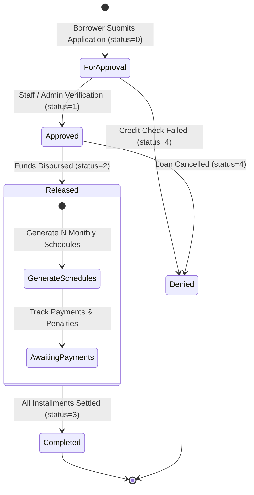

# System Architecture Documentation

## 1. Architectural Overview

The **Loan Management System** is built as a modular monolithic web application leveraging a decoupled request-response model via asynchronous JavaScript (AJAX) and server-side PHP. It connects to a MySQL/MariaDB relational database using MySQLi prepared statements.

```
┌────────────────────────────────────────────────────────┐
│                   CLIENT BROWSER                       │
│  HTML5 + Bootstrap 4 + FontAwesome 5 + Custom CSS      │
│  DataTables, Select2, DateTimePicker, jQuery           │
└───────────────────────────┬────────────────────────────┘
                            │ Asynchronous HTTP / AJAX
                            ▼
┌────────────────────────────────────────────────────────┐
│                   ROUTING & SECURITY                   │
│  index.php (Strict Page Whitelist)                     │
│  ajax.php  (Authentication & Role-Based RBAC Guard)   │
│  security.php (CSRF Token & XSS Escaping Engine)       │
└───────────────────────────┬────────────────────────────┘
                            │ Method Dispatch
                            ▼
┌────────────────────────────────────────────────────────┐
│               SERVICE & BUSINESS LOGIC                 │
│  admin_class.php (Class Action)                        │
│  - User Auth & Bcrypt Hash Auto-Migration              │
│  - Loan Application & Amortization Calculations        │
│  - Schedule Generator & Penalty Assessment             │
│  - Borrower & Payment Transaction Management           │
└───────────────────────────┬────────────────────────────┘
                            │ Parameterized SQL
                            ▼
┌────────────────────────────────────────────────────────┐
│                   DATABASE STORAGE                     │
│  MySQL / MariaDB (`loan_db`)                           │
│  InnoDB Engine, utf8mb4 Charset, Performance Indexes   │
└────────────────────────────────────────────────────────┘
```

---

## 2. Component Breakdown

### A. Routing & View Layer
- **`index.php`**: The primary administrative frame. It renders the global top navigation bar (`topbar.php`), collapsible side menu (`navbar.php`), and modal dialogs. Page rendering utilizes an explicit whitelist array (`home`, `loans`, `borrowers`, `payments`, `plan`, `loan_type`, `users`). Any arbitrary or path-traversing parameter is safely defaulted to `home`.
- **`ajax.php`**: Centralized API gateway. Every asynchronous state mutation dispatches through `ajax.php`, which validates active session state, role authorization, and CSRF token integrity before calling backend service methods.
- **`security.php`**: Security middleware providing:
  - `csrf_token()`: Generates and persists a 64-character cryptographic hex token.
  - `validate_csrf()`: Compares incoming tokens via `hash_equals()` from HTTP headers (`X-CSRF-Token`) or POST bodies.
  - `escape()`: Context-aware HTML entity sanitizer preventing Cross-Site Scripting (XSS).
  - `require_auth()` and `require_admin()`: Declarative gatekeepers.

### B. Service & Business Layer (`admin_class.php`)
Encapsulated within the `Action` class:
- **Authentication**: `login()` and `login2()` evaluate credentials against Bcrypt hashes using `password_verify()`. If an existing user logs in with legacy plaintext or MD5, the system validates the password and immediately re-hashes it with `password_hash($password, PASSWORD_DEFAULT)`.
- **Loan Processing**: `save_loan()` manages lifecycle transitions (Request $\rightarrow$ Approved $\rightarrow$ Released $\rightarrow$ Completed $\rightarrow$ Denied).
- **Schedule Generation**: When a loan transitions to status `2` (Released), the system queries the associated loan plan's tenor in months and calculates incrementing monthly payment due dates in `loan_schedules`.
- **Penalty Computation**: Past-due installments are detected dynamically by comparing calendar dates against due dates:
  $$\text{Is Overdue} = (\text{Due Date} < \text{Current Date})$$
  $$\text{Penalty Due} = \text{Monthly Payable} \times \left(\frac{\text{Penalty Rate}}{100}\right)$$

---

## 3. Key Operational Workflows

### Loan Lifecycle & Status Flow


### Repayment Calculation Engine
1. **Total Interest**:
   $$\text{Total Interest} = \text{Principal} \times \left(\frac{\text{Interest Percentage}}{100}\right)$$
2. **Monthly Payable Amount**:
   $$\text{Monthly Payable} = \frac{\text{Principal} + \text{Total Interest}}{\text{Months}}$$
3. **Overdue Penalty**:
   $$\text{Monthly Penalty} = \text{Monthly Payable} \times \left(\frac{\text{Penalty Rate}}{100}\right)$$
4. **Current Installment Offset**:
   Determined by counting previously recorded payments for the specific loan ID:
   $$\text{Next Installment Index} = \text{Count}(\text{Payments}) + 1$$
