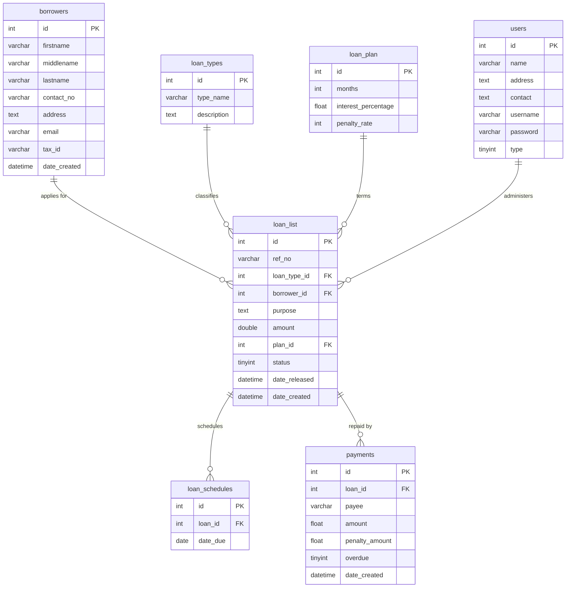

# Database Schema & Migration Guide

## 1. Overview

The **Loan Management System** utilizes a normalized relational database named `loan_db` hosted on MySQL / MariaDB (InnoDB storage engine, `utf8mb4` encoding).

---

## 2. Entity-Relationship Diagram (ERD)

---

## 3. Data Dictionary

### Table: `users`
Administrative and staff system accounts.
| Column | Type | Nullable | Key | Default | Description |
| :--- | :--- | :--- | :--- | :--- | :--- |
| `id` | `INT(30)` | No | PK | Auto | Unique account ID |
| `name` | `VARCHAR(200)` | No | | | User's full name |
| `address` | `TEXT` | No | | | Residential address |
| `contact` | `TEXT` | No | | | Phone / mobile number |
| `username` | `VARCHAR(100)` | No | | | Unique login username |
| `password` | `VARCHAR(200)` | No | | | Bcrypt password hash (`$2y$...`) |
| `type` | `TINYINT(1)` | No | | `2` | Role: `1` = Admin, `2` = Staff, `3` = Customer |

### Table: `borrowers`
Borrower contact and identity profiles.
| Column | Type | Nullable | Key | Default | Description |
| :--- | :--- | :--- | :--- | :--- | :--- |
| `id` | `INT(30)` | No | PK | Auto | Primary key |
| `firstname` | `VARCHAR(100)` | No | | | First name |
| `middlename`| `VARCHAR(100)` | No | | | Middle name |
| `lastname` | `VARCHAR(100)` | No | | | Last name |
| `contact_no`| `VARCHAR(30)` | No | | | Phone number |
| `address` | `TEXT` | No | | | Physical residential address |
| `email` | `VARCHAR(50)` | No | | | Email address |
| `tax_id` | `VARCHAR(50)` | No | | | Government Tax ID / SSN |
| `date_created` | `INT(11)` | No | | `0` | Creation timestamp |

### Table: `loan_types`
Categories of lending products offered.
| Column | Type | Nullable | Key | Default | Description |
| :--- | :--- | :--- | :--- | :--- | :--- |
| `id` | `INT(30)` | No | PK | Auto | Primary key |
| `type_name` | `TEXT` | No | | | Product category name |
| `description`| `TEXT` | No | | | Extended description |

### Table: `loan_plan`
Amortization parameters specifying duration, rate, and overdue penalties.
| Column | Type | Nullable | Key | Default | Description |
| :--- | :--- | :--- | :--- | :--- | :--- |
| `id` | `INT(30)` | No | PK | Auto | Primary key |
| `months` | `INT(11)` | No | | | Loan tenor in months |
| `interest_percentage` | `FLOAT` | No | | | Total interest percentage |
| `penalty_rate` | `INT(11)` | No | | | Monthly overdue penalty percentage |

### Table: `loan_list`
Central transaction registry tracking loan applications, disbursement, and status.
| Column | Type | Nullable | Key | Default | Description |
| :--- | :--- | :--- | :--- | :--- | :--- |
| `id` | `INT(30)` | No | PK | Auto | Primary key |
| `ref_no` | `VARCHAR(50)` | No | | | Generated unique reference code |
| `loan_type_id` | `INT(30)` | No | FK | | Reference to `loan_types.id` |
| `borrower_id` | `INT(30)` | No | FK | | Reference to `borrowers.id` |
| `purpose` | `TEXT` | No | | | Purpose of the loan |
| `amount` | `DOUBLE` | No | | | Approved principal amount |
| `plan_id` | `INT(30)` | No | FK | | Reference to `loan_plan.id` |
| `status` | `TINYINT(1)` | No | | `0` | `0`=Request, `1`=Approved, `2`=Released, `3`=Completed, `4`=Denied |
| `date_released` | `DATETIME` | No | | | Timestamp when funds were released |
| `date_created` | `DATETIME` | No | | `CURRENT_TIMESTAMP` | Application submission timestamp |

### Table: `loan_schedules`
Calculated due dates for monthly installments generated upon release.
| Column | Type | Nullable | Key | Default | Description |
| :--- | :--- | :--- | :--- | :--- | :--- |
| `id` | `INT(30)` | No | PK | Auto | Primary key |
| `loan_id` | `INT(30)` | No | FK | | Associated loan reference |
| `date_due` | `DATE` | No | | | Date payment is due |

### Table: `payments`
Repayment audit logs.
| Column | Type | Nullable | Key | Default | Description |
| :--- | :--- | :--- | :--- | :--- | :--- |
| `id` | `INT(30)` | No | PK | Auto | Primary key |
| `loan_id` | `INT(30)` | No | FK | | Associated loan reference |
| `payee` | `TEXT` | No | | | Name of person remitting payment |
| `amount` | `FLOAT` | No | | `0` | Amount paid toward monthly amortization |
| `penalty_amount` | `FLOAT` | No | | `0` | Overdue penalty portion collected |
| `overdue` | `TINYINT(1)` | No | | `0` | `0` = on time, `1` = overdue |
| `date_created` | `DATETIME` | No | | `CURRENT_TIMESTAMP` | Timestamp payment recorded |

---

## 4. Migration & Optimization Script

The database contains an automated, non-destructive migration script at `database/migration_security_and_cleanup.sql` which safely:
1. Removes unused legacy columns (`doctor_id`).
2. Upgrades default admin credentials to modern Bcrypt hashes.
3. Applies high-performance composite indexes on foreign keys:
   - `loan_list(borrower_id, status)`
   - `loan_list(plan_id)`
   - `loan_schedules(loan_id, date_due)`
   - `payments(loan_id)`
